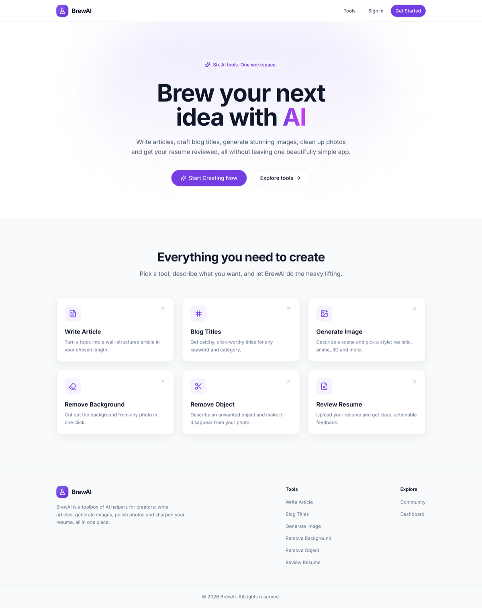
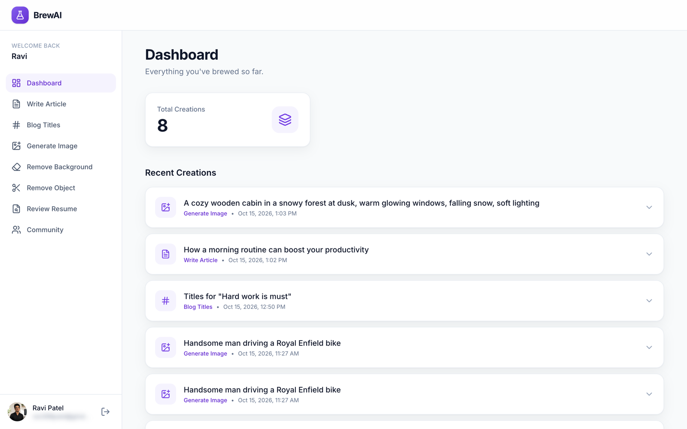
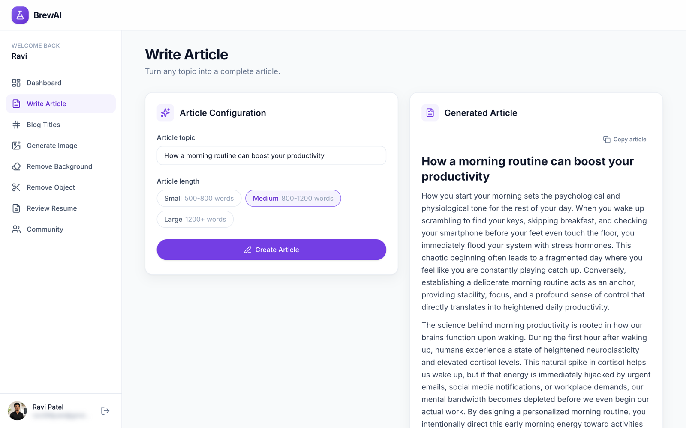
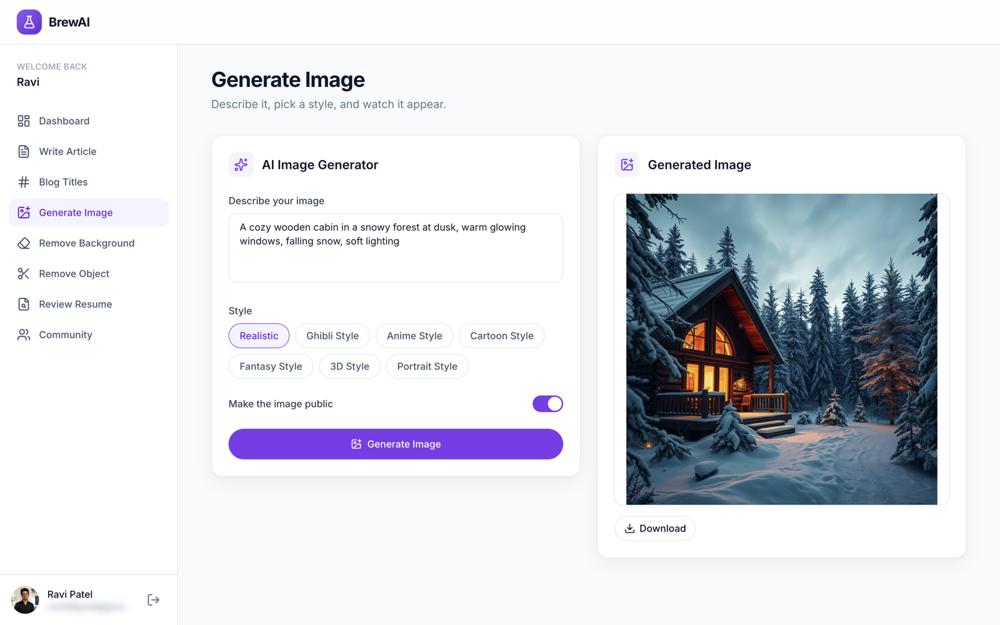
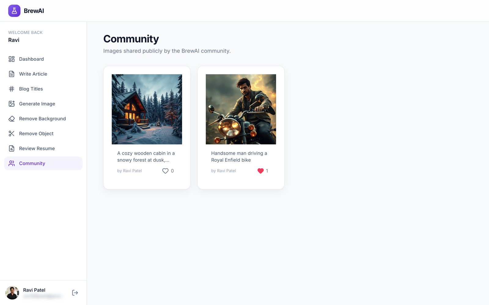

# BrewAI

A full-stack MERN app that bundles six AI tools into one clean workspace: write articles, craft blog titles, generate images, remove backgrounds, remove objects from photos, and get a resume reviewed. Includes Clerk authentication, a personal dashboard, and a community feed of public images.

**Live demo:** https://brewai-alpha.vercel.app
**API:** https://brewai.onrender.com

> The API runs on Render's free tier and sleeps when idle, so the first request after a pause can take 30–50 seconds.



## Screenshots

| Dashboard | Write Article |
|---|---|
|  |  |
| **Generate Image** | **Community** |
|  |  |

## Features

| Tool | What it does | Powered by |
|---|---|---|
| Write Article | Article from a topic, in a chosen length | Google Gemini |
| Blog Titles | Click-worthy titles for a keyword and category | Google Gemini |
| Generate Image | Text-to-image in several styles, optionally published to Community | Cloudflare Workers AI (FLUX.1 schnell) + Cloudinary |
| Remove Background | One-click background removal | Cloudinary AI |
| Remove Object | Describe an object and it disappears from the photo | Cloudinary Generative Remove |
| Review Resume | PDF/image resume → structured score and feedback | Gemini (JSON mode) |

Also: **Dashboard** (all your creations and stats), **Community** (public generated images with likes), **Clerk** sign-in plus profile and avatar management.

## Tech stack

- **Frontend:** React 19, Vite, React Router v7, Tailwind CSS v4, lucide-react, Clerk (`@clerk/react`)
- **Backend:** Node.js, Express 5, Mongoose, Multer, Clerk (`@clerk/express`)
- **Data and AI:** MongoDB Atlas, Cloudinary, Google Gemini (`@google/genai`), Cloudflare Workers AI
- **Hosting:** Vercel (client), Render (server)

## Architecture

```
React (Vercel) ──Bearer token──▶ Express (Render) ──▶ MongoDB Atlas
                                      │
                                      ├──▶ Gemini            (text, resume review)
                                      ├──▶ Cloudflare AI     (image generation)
                                      └──▶ Cloudinary        (storage, bg/object removal)
```

```
brewai/
├── client/src/
│   ├── components/   ui/ · layout/ · tools/ · dashboard/ · community/ · auth/
│   ├── pages/        landing page + app/ (one page per tool)
│   ├── hooks/        useAsyncAction, useApiData, useCurrentUser, …
│   ├── services/     api.js: the only place that talks to the backend
│   └── config/       tool and option definitions
└── server/
    ├── routes/       URL → controller mapping
    ├── controllers/  request handling and validation
    ├── models/       Creation (single collection for every tool)
    ├── middlewares/  protect (auth), uploadFile (multer)
    └── services/     textAI, imageAI, cloudinaryService (provider code isolated)
```

### Design decisions

- **One `Creation` collection.** Every tool result is a document. Community is just a filtered query (`isPublic: true`, generated images only), backed by a partial index.
- **Providers behind service files.** Swapping an AI provider (done twice during development) touches one file, not the controllers.
- **Auth on the server.** Clerk JWTs are verified by middleware, and the user id comes from the token, never from the request body.
- **Defensive inputs.** Upload type and size limits, sanitised text before it enters Cloudinary URL transformations, prompt-injection guard for resume text, and orphaned Cloudinary files cleaned up if a save fails.
- **Privacy by default.** Responses hide `userId`, `publicId` and the raw `likedBy` list. Each viewer only sees `likedByMe`.

## API

All routes require a Clerk session token (`Authorization: Bearer <token>`).

| Method | Route | Purpose |
|---|---|---|
| POST | `/api/ai/write-article` | Generate an article |
| POST | `/api/ai/blog-titles` | Generate blog titles |
| POST | `/api/ai/generate-image` | Generate an image |
| POST | `/api/ai/remove-background` | Multipart upload, field `image` (JPG/PNG/WebP, ≤10 MB) |
| POST | `/api/ai/remove-object` | Multipart upload, fields `image` and `object` |
| POST | `/api/ai/review-resume` | Multipart upload, field `resume` (PDF/JPG/PNG, ≤5 MB) |
| GET | `/api/creations` | Your creations and totals |
| GET | `/api/community` | Public images |
| POST | `/api/community/:id/like` | Toggle a like |

## Run locally

Requirements: Node 20+, a MongoDB database, and accounts for Clerk, Cloudinary, Google AI Studio and Cloudflare.

```bash
git clone https://github.com/ravi-2k/brewai.git
cd brewai

# server
cd server && npm install
cp .env.example .env      # fill in the values
npm run server            # http://localhost:4000

# client (new terminal)
cd client && npm install
cp .env.example .env.local   # set VITE_CLERK_PUBLISHABLE_KEY
npm run dev               # http://localhost:5173 (proxies /api to :4000)
```

### Environment variables

| Server (`server/.env`) | Client (`client/.env.local`) |
|---|---|
| `MONGO_URI` | `VITE_CLERK_PUBLISHABLE_KEY` |
| `CLERK_PUBLISHABLE_KEY`, `CLERK_SECRET_KEY` | `VITE_API_URL` (production only; empty in dev) |
| `GEMINI_API_KEY` | |
| `CLOUDINARY_CLOUD_NAME`, `CLOUDINARY_API_KEY`, `CLOUDINARY_API_SECRET` | |
| `CLOUDFLARE_ACCOUNT_ID`, `CLOUDFLARE_API_TOKEN` | |
| `CLIENT_URL` (comma-separated allowed origins, production) | |

## Deployment

- **Server → Render:** root directory `server`, build `npm install`, start `npm start`, plus the environment variables above.
- **Client → Vercel:** root directory `client`, with `VITE_CLERK_PUBLISHABLE_KEY` and `VITE_API_URL` set. `vercel.json` rewrites all routes to `index.html` for the SPA.

## Possible next steps

Delete-creation endpoint, per-user rate limiting, tests, Clerk production instance with a custom domain.

## Author

Built by [Ravi Patel](https://github.com/ravi-2k) as a MERN practice project.
